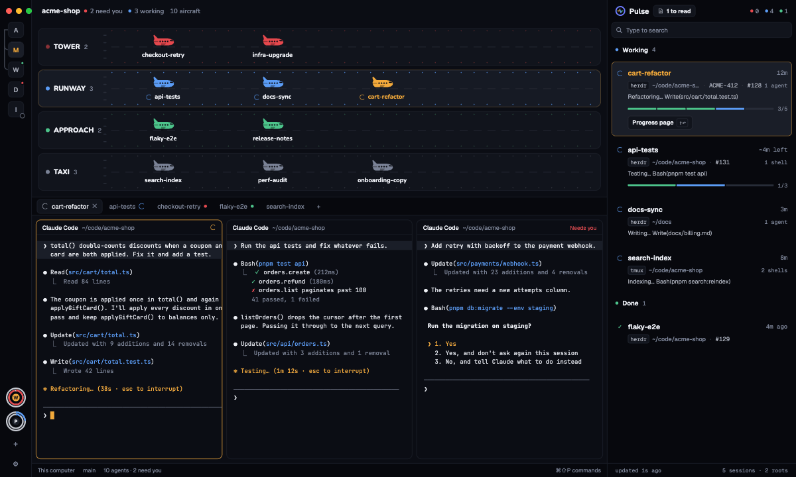

# Control Tower

A night air-traffic-control layout for [Herdr](https://herdr.dev). Every agent is an aircraft on one of four runways: TOWER (needs you), RUNWAY (working), APPROACH (done, unseen) and TAXI (idle). When an agent's status changes, its aircraft slides to the new runway. The chrome stays a quiet ink-grey console; status color is only a dot beside each runway name, and amber marks the agent you're focused on.



The preview and the animation use made-up agents and terminals. They are rendered by `art/render.mjs` from `art/preview.html`, a sample-data copy of the window that follows the mods' sizes and colors.

## Add it

Paste this into an agent running in Herdr:

```
Read ~/.config/herdr-app/AGENTS.md, then add this layout: https://github.com/lcalmsky/herdr-control-tower
```

Before adding it, know what the mods run and read outside their folders:

- the `pulse` mod runs `sh mods/pulse/scan.sh` every 3 s. The script reads Claude Code's session records and transcripts under `~/.claude` (or `$CLAUDE_CONFIG_DIR`) and under each `~/.claude-accounts/*` that has a `sessions/` folder; the deadhd checklist state under `/tmp/deadhd-state` (or `$DEADHD_STATE_DIR`); page alerts under `~/.pulse/pages` (or `$PULSE_PAGES_DIR`); and the environment of the session processes through `ps eww`, for the pane, tab, workspace and Orca handle variables. It writes only a ledger cache under `${TMPDIR:-/tmp}/herdr-pulse`, and it never opens `*.key` files.
- the `pulse` view runs `tmux` to switch a session, the Orca CLI at `/Applications/Orca.app/Contents/Resources/bin/orca`, `open` for page URLs and `open -a Orca`, and `rm -f` on the page-alert files after it opens them. Pages open in your browser.
- `tower` reads Herdr's own agent and space state and runs no programs. `tower-rail` also reads that state; every 30 s it runs `git -C <terminal cwd> rev-parse --path-format=absolute --git-common-dir --show-toplevel` for each distinct terminal cwd, which reads git metadata outside the mod folder, and it reorders spaces with `space.move` so each repository's spaces sit together (base checkout first).

Pulse's focus key is not shipped with this repo. To give the panel the keyboard, add `"ctrl-alt-p": "pulse.toggle"` to the `global` section of your Herdr `keys.json`.

The account avatars at the bottom of the rail and their popup are the [claude-accounts](https://github.com/lcalmsky/herdr-claude-accounts) mod, shipped here as `mods/claude-accounts/`. Its README lists what it runs and reads: it executes `cca` (a `sh` script in that folder) every 30 s, which reads account emails and usage files and the focused Claude process's environment; **Add account** and `cca share` write under `~/.claude-accounts` and create the shared history entries under `~/.claude`. That mod makes no network calls.

The mods themselves make no network calls. `RECIPE.md` is the brief to build it from scratch.

## Usage (optional)

The account menu can show each account's 5h and weekly usage. Claude Code hands its rate limits only to the status line command, so put `usage-tap.sh` in front of it in `~/.claude/settings.json`:

```json
"statusLine": {
  "type": "command",
  "command": "sh $HOME/.config/herdr-app/mods/claude-accounts/usage-tap.sh node ${CLAUDE_CONFIG_DIR:-$HOME/.claude}/hud/hud-with-peers.mjs"
}
```

Keep your own status line command after the tap path unchanged. The tap passes the same input through, writes `${XDG_STATE_HOME:-$HOME/.local/state}/herdr-tower/usage/<account>.json` when `node` is available, prints nothing of its own and never breaks the status line.

## License

MIT for the layout, theme, `tower`, `tower-rail`, `pulse` and the bundled `claude-accounts` mod. `mods/tower-tabs` is modified from Herdr's shipped `tabs` mod and stays under the Apache License 2.0 (`mods/tower-tabs/LICENSE`). The bundled Nunito font is under the SIL Open Font License 1.1 (`mods/tower/fonts/OFL.txt`).
