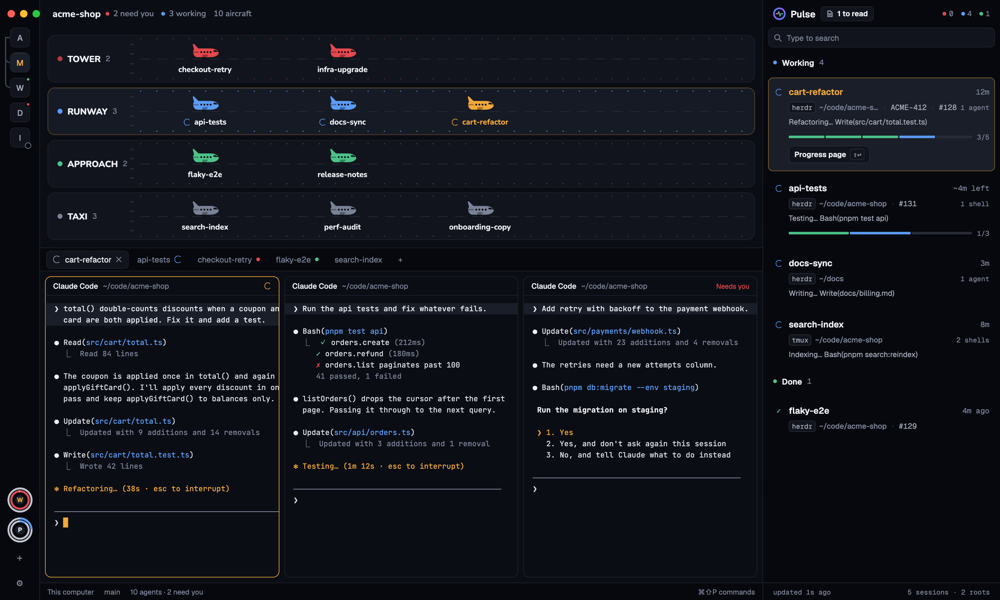

# Control Tower

A quiet night-console window for watching agents. A thin rail of space tiles runs down the left. Across the top, four fixed runways hold your agents as aircraft: TOWER (needs you), RUNWAY (working), APPROACH (done while you weren't looking) and TAXI (idle). Each aircraft carries a controller tag with the session name, what the agent is doing and how full its context is. When a status changes the aircraft slides to its new runway. Everything is ink-grey; status color is only a small dot beside each runway name and a red waiting aircraft, and amber marks the agent you're focused on. Terminals sit below as rounded cards.

## What you see

Left to right, then top to bottom:

- **Rail** (64 px, not resizable, drags the window, `chrome` background `#07080d`). Space tiles start 44 px from the top (room for the traffic lights at [12, 16]), 32 px squares with radius 8, 8 px apart: `#11141c` with a 1 px `#1d212b` hairline and the space name's first letter (13 px, weight 500, `#a3a9b8`). The shown space is `#1a1e28` with a white letter `#eef0f5` and a 1 px `#ffffff1f` highlight along its top edge. An 8 px dot with a 2 px `#07080d` ring sits on a tile's top-right corner: red `#e5484d` when an agent there is blocked, green `#4cc38a` when one finished unseen. At the bottom: 32 px + (new space) and settings buttons in `#7a8296`.
- **Head** (44 px, drags the window, 20 px side padding): the shown space's name (Nunito 15 px bold, `#eef0f5`) and "N aircraft · 4 runways" (Nunito 13 px semibold, `#7a8296`); at the right end, after a spacer, the account chip: 26 px tall, radius 13, `#11141c` with a 1 px `#1d212b` hairline (hover `#161a24`), a 20 px round avatar (`#1a1e28`, the name's first letter, Nunito 11 px bold `#eef0f5`), the account name (Nunito 13 px semibold `#eef0f5`) and "▾" (`#7a8296`), padding 3 px left and 10 px right, tooltip "Claude accounts". It names the account of the focused Claude Code agent, else `default`.
- **Runways** (384 px block, 12 px padding): four cards 84 px tall, 8 px apart, radius 12, `#11141c` with a 1 px `#1d212b` hairline. Their height never changes, empty or not.
  - Label, 16 px in: an 8 px status dot, the runway name (Nunito 14 px, weight 800, `#eef0f5`), the count (Geist Mono 12 px, `#7a8296`); below it, indented 16 px, "Needs you / Working / Done, unseen / Idle" (Nunito 12 px semibold, `#7a8296`).
  - Status dots: TOWER `#e5484d`, RUNWAY `#5b9cf5`, APPROACH `#4cc38a`, TAXI `#7a8296`.
  - A dashed centre line from 148 px to 16 px before the right edge: 16 px dashes, 12 px gaps, 1 px, `#272c37`.
  - An empty runway shows "No aircraft" (Nunito 12 px semibold, `#7a8296`) at its right end.
- **Aircraft**: a 26 px plane (side view, nose right) then, 8 px later, a 240 × 64 controller tag (radius 8, `#1a1e28`, 1 px `#1d212b` hairline, 12 px side and 8 px vertical padding) with three 16 px rows:
  1. the session name (Nunito 14 px bold, `#eef0f5`, taking the rest of the row) and the time since the status changed (Geist Mono 12 px, `#7a8296`: `<1m`, `5m`, `2h`, `1d`);
  2. an 11 px spinner (working only) and what it's doing (Geist Mono 12 px, `#a3a9b8`);
  3. the space name (Nunito 12 px semibold, `#7a8296`, taking the rest of the row), a 72 px wide 2 px context bar (`#1d212b` track, `#a3a9b8` fill) and the percentage (Geist Mono 12 px, `#7a8296`; `–` when unknown).
  Planes are `#7a8296`; a waiting (TOWER) plane is red and its tag border is red at 50 %. Aircraft on one runway line up from the left, 298 px apart, starting 156 px into the card.
- **Tab bar** (38 px): Herdr's tabs, except an unnamed tab shows its agent's session name (else its space's name) instead of its number.
- **Work area**: padding 8, gap 8. Each pane is a card with radius 10, a 1 px `border` (1 px `accent`, amber, when focused) and Herdr's 30 px pane header.
- **Status bar** (28 px): Herdr's workspace status.
- **Theme** `control-tower`: background/canvas `#0b0d14`, chrome `#07080d`, foreground `#eef0f5`, border `#1d212b`, selected `#1a1e28`, hover `#161a24`, muted `#7a8296`, accent and cursor `#f2a93b`, selection `#26304a`, bright ANSI colors for terminal output.

## How it behaves

- **Status → runway**: blocked → TOWER, working → RUNWAY, done → APPROACH, idle → TAXI. On a change the aircraft slides (left and top, 400 ms ease-out) to its new place. On each runway the most recent change comes first, and the same order is handed to Herdr (`setAgentOrder`).
- **Focus**: the focused agent's runway steps up to `#161a24` with an amber hairline at 30 % and a 1 px `#ffffff14` highlight along its top. That aircraft's plane, tag border, session name and context bar turn amber `#f2a93b`. Nothing glows, pulses or loops; the only continuous motion is the working spinner.
- **What it's doing**: every 2.5 s the screen of each working or blocked agent is read. Working shows Claude Code's spinner verb ("Cogitating…") and the last tool call (`Edit(main.kt)`); blocked shows the last line ending in "?". Done shows "Done", idle "Idle".
- **Context**: every 10 s, for local Claude Code agents, the newest assistant usage in the agent's own transcript (input + cache creation + cache read + output) against 200k, or 1M when the model name has `[1m]` or usage passes 200k. A compaction (a `"subtype": "compact_boundary"` line) after the last usage clears it to `–`; a pid the script can't read keeps its last value.
- **Session name**: the agent's terminal title (Claude Code sets it) without leading symbols; when the title is a path, has `@` or is just the program name, the tab name; else the program name.
- **Clicks**: an aircraft focuses its pane (`pane.focus`); resting the pointer on it shows a tooltip with the full session name, space name and status, joined by " · ". A rail tile selects its space; right-click opens Herdr's space menu; hovering shows "N. name". + runs `space.new`, the gear `app.settings`. The tab bar works like Herdr's.
- **Accounts**: an account is one Claude Code config dir. `default` is `$HOME/.claude` (state `$HOME/.claude.json`); every `$HOME/.claude-accounts/<name>/` is another (state `<dir>/.claude.json`, signed-in email at `oauthAccount.emailAddress`). The head names the account of the focused Claude Code agent from that pid's environment (`ps -E -ww -p <pid> -o command=`, the `CLAUDE_CONFIG_DIR=<dir>` token): no token or `$HOME/.claude` is `default`, `$HOME/.claude-accounts/<name>` is `<name>`, any other dir shows its last path component. With no Claude agent focused, `default`. The chip polls that with one read-only `sh` script on the head's 30 s timer and whenever the focused pid changes; the same run reads each account's usage file (below) and the focused pid's `$HOME/.claude/sessions/<pid>.json` for `sessionId` and `cwd`.
- **Account menu**: clicking the chip opens a 260 px pointer popup of the same mod (`props {role: "accounts"}`, height 67 + 38 px per account, plus 18 + 26 px per resume row). It is headed "OPEN IN A NEW TAB". Each 38 px row: a "✓" (amber) on the chip's current account, an 18 px round avatar, the account name (Nunito 12 px semibold `#eef0f5`), a 5 px amber dot when it has the most 5h headroom, then right-aligned the signed-in email (Geist Mono 10.5 px `#7a8296`; "not signed in" when none) and under it its usage `5h 12% · 7d 9%` (Geist Mono 10.5 px `#7a8296`; the 5h percentage in `#e5484d` at 100 %; `↻HH:MM` after a window used 90 % or more; "no usage yet" without a usage file). Hovering a row fills `#161a24`. Choosing a row closes the menu and runs `tab.new` in the focused space with `sh -lc 'CLAUDE_CONFIG_DIR=<dir> exec claude'` (for `default`, `unset CLAUDE_CONFIG_DIR` instead: set to `~/.claude`, Claude Code reads `~/.claude/.claude.json` rather than `~/.claude.json` and starts empty); running agents keep their account. When the focused agent is a local Claude Code process with a session file, a "Continue this session as" section lists every other account (26 px rows, avatar and name, "resume" at the right); choosing one runs `tab.new {name, folder: cwd, argv: ["sh","-lc","<env> exec claude --resume <sessionId>"]}` after the session id passes a UUID test, and leaves the old tab running. "+ Add account…" opens a 260 × 170 add popup: a name field (`A-Z a-z 0-9 _ -`, not `default`; account folders with other names are left out of the menu), Cancel and Create. Create makes `$HOME/.claude-accounts/<name>/` and symlinks every entry of `~/.claude` into it except login and per-process state (`.credentials.json`, `.claude.json`, `shell-snapshots`, `statsig`, `ide`, `debug`, `backups`, `telemetry`, `cache`, `transcripts`, `jobs`, `logs`, `daemon*`, `.session-stats.json`, `.last-*`, `*.lock`), then opens the login tab the same way; an invalid or existing name stays in the popup with the reason.
- **Shared history**: `projects`, `history.jsonl`, `file-history`, `todos`, `plans`, `tasks`, `teams`, `paste-cache`, `session-env` and `sessions` live once under `~/.claude` and are linked into every account, so `claude -c` / `claude --resume` and the session list are the same in all of them. The add step creates any missing entry under `~/.claude` first (`mkdir -p`; `touch history.jsonl`) so Claude Code cannot make a private copy inside the account folder. Sharing an account created by an earlier version is a manual step: the add step refuses an existing folder, so the mod never migrates one. To do it by hand, replace each of the account's real history entries with a symlink to the same entry under `~/.claude`, merging any existing content first (`cp -Rn`; append `history.jsonl` line by line); an entry absent under `~/.claude` is just linked.
- **Account usage (optional)**: `mods/tower/usage-tap.sh` wraps the status line (see README). It copies stdin to a temp file, reads `rate_limits.five_hour` / `rate_limits.seven_day` (`used_percentage`, `resets_at`) with `node -e`, keeps the newer value per window (a window that starts more than an hour later is newer; inside one window a lower percentage is stale) and writes `{"five_hour":{"used":..,"resets_at":..},"seven_day":{..},"updated_at":<epoch s>}` atomically to `${XDG_STATE_HOME:-$HOME/.local/state}/herdr-tower/usage/<account>.json`, naming the account from `CLAUDE_CONFIG_DIR` as above. It then `exec`s the original command with the same stdin. Without `node` it records nothing; any error just runs the original command. It prints nothing and makes no network calls.
- The head and timers refresh every 30 s.

## Built from

- `layouts/control-tower.json`: root `row` (theme `control-tower`, background `canvas`, titlebar none, traffic_lights [12, 16], terminal_padding [14, 12], 1 px `border` dividers):
  - `rail` block (px 64, not resizable, `window_drag`, background `chrome`) with `tower-rail`;
  - `work` column: `tower-head` (px 44, `window_drag`, `tower` with props `{role: "head"}`), `tower-lanes` (px 384, `tower`), `tabs` (px 38, `tower-tabs`), `work-body` row (padding 8, gap 8) with `main` (`{tab: "active", pane: {header: {content: {mod: "pane"}, reveal: "always", height: 30, position: "top"}, background: "background", border 1 `border`, focus 1 `accent`, radius 10, gap 8, lone: true}}`), and `status` (px 28, the shipped `workspace-status`).
- `themes/control-tower.json`: the theme above.
- `mods/tower/`: `props().role === "head"` draws the head and its account chip, `"accounts"` the account menu (with `props().mode === "add"` the add form), anything else the runways. The chip opens the menu with `openOverlay({mod: "tower", kind: "popup", width: 260, props: {role: "accounts", current, accounts, session}})`; the menu closes itself with `closeOverlay(props().overlay)`. `plane.svg` is the aircraft (one path set, tinted with `text_color`). `usage-tap.sh` is the optional status-line tap described above. `fonts/` holds Nunito SemiBold and Bold (OFL), picked up automatically and used through `font_family("Nunito")`.
- `mods/tower-rail/`: the rail.
- `mods/tower-tabs/`: Herdr's shipped `tabs` (0.1.12), modified: an unnamed tab shows the lead agent's terminal title, else its space's name; the bar's left padding is a fixed 10 px. Apache-2.0, with its LICENSE.
- `herdr` functions: `agents`, `terminals`, `spaces`, `panes`, `focused`, `run`, `exec`, `hc`, `props`, `shared`, `setAgentOrder`, `openOverlay`, `closeOverlay`, `theme`, `window`, `layout`.
- Commands: `pane.focus`, `space.select`, `space.new`, `app.settings`, and the tab bar's `tab.*`, `layout.show/hide/select`, `window.*`.
- Shipped mods and icons: `pane`, `workspace-status`, `menu`, `new-menu`, and icons from `mods/workspace-chrome/` (spinner, plus, settings), `mods/pane/`, `mods/files/`, `mods/changes/`.
- Programs: `hc read <address>` (screens) and `sh -c` with a read-only script over `sessions/<pid>.json` and `projects/*/<session>.jsonl` under `${CLAUDE_CONFIG_DIR:-$HOME/.claude}` then `$HOME/.claude-accounts/*` (the first root holding the session wins; one `mktemp` file, removed by a `trap` on exit). The head's 30 s read is one `sh` script: `ps -E -ww -p <pid> -o command=` for the focused account, `oauthAccount.emailAddress` from `$HOME/.claude.json` and `$HOME/.claude-accounts/*/.claude.json`, `grep` over `${XDG_STATE_HOME:-$HOME/.local/state}/herdr-tower/usage/<account>.json`, and `sessionId`/`cwd` from `$HOME/.claude/sessions/<pid>.json`. "Add account" runs one `sh` script that `mkdir -p`s the shared history entries under `~/.claude`, `mkdir -p`s `$HOME/.claude-accounts/<name>` and `ln -s` the rest; choosing an account runs `tab.new` with `sh -lc`, and "Continue this session as" runs it with `claude --resume <sessionId>`. No network.

## Watch out

- `agent.focused` isn't enough to find the selection; also compare `focused().terminal` / `focused().agent` with the agent's address.
- Only opacity, width, height, left and top animate. Aircraft keep a stable element id per agent (`slot-<address>`) and are drawn in address order so they slide instead of jumping.
- Runways keep their height when empty on purpose: collapsing them would shift every runway below on each status change and bury the one move that matters.
- A block doesn't report its width, so tags are fixed px and the runway clips. The dashes are a fixed count (80) that covers a wide window. A runway shows about four aircraft on a 1600 px window; more run off the right edge.
- The runway block is sized for four 84 px runways with 8 px gaps (4 × 84 + 3 × 8 + 24 padding = 384). Changing the runway height means changing the layout's px too.
- GPUI colors accept `#rrggbbaa`; the waiting tag's red border at 50 % and the selected runway's amber hairline at 30 % use it.
- Screen reading matches Claude Code's spinner and tool lines; other agents show only their status word. Context use is Claude Code only (local terminals).

## Done when

- `herdr-app check mods/tower`, `mods/tower-rail` and `mods/tower-tabs` all pass, and `layout.switch {name: "control-tower"}` shows the rail, head, four runways, tabs and panes with no errors in `herdr-app status`.
- Starting an agent puts an aircraft on RUNWAY with a spinner; when it waits for permission the aircraft slides to TOWER with a red plane; when it finishes unfocused it slides to APPROACH. No runway changes height.
- Clicking an aircraft focuses its pane; that aircraft turns amber and its runway steps up while the previous one returns to `#11141c`.
- A Claude Code agent's tag shows a context percentage within 10 s, and its session name matches its terminal title.
- An unnamed tab shows the session name (or, with no usable title, the space name) instead of a number.
- The head's right end shows the account chip naming the focused Claude Code agent's account (from its `CLAUDE_CONFIG_DIR`), including for an agent whose `sessions/<pid>.json` is shared; clicking it lists the default and `~/.claude-accounts/*` accounts with their emails and a "✓" on the current one, and choosing one opens that account's Claude Code in a new tab.
- With the tap wired, choosing an account shows `5h 12% · 7d 9%` under its email within one status-line refresh; an account with no usage file shows "no usage yet", and the account with the most 5h headroom carries the amber dot.
- With a local Claude Code agent focused and another account present, the menu's "Continue this session as" row resumes that agent's `sessionId` under the other account in a new tab at the same `cwd`, and the old tab keeps running.
- A new account created from the menu has `projects`, `sessions`, `history.jsonl` and the other shared history entries linked into `~/.claude`, so `claude --resume` and the session list work across accounts.
